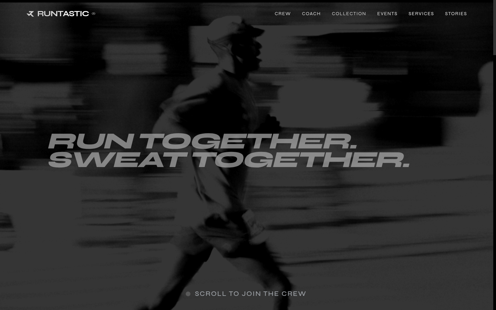

# Running Community Landing

Marketing site for an urban running community: manifesto, weekly runs, coaching, crew, merchandise and member stories.

Live at [runtastic-landing.vercel.app](https://runtastic-landing.vercel.app).



## What is on it

- **Home**: hero, manifesto and a call to join the crew
- **Events**: Easy Run, Night Run and Fun Run
- **Coach** and **Services**: training programmes and what members get
- **Crew**: the people behind the community
- **Collection**: merchandise
- **Stories**: member stories with a detail page for each
- **Privacy** and **Terms**

Copy is bilingual (Indonesian and English) and image alt text is written for local search.

## Stack

React 18 and TypeScript on Vite, Tailwind CSS with shadcn/ui (Radix) components, Embla for carousels, and Vercel
Analytics with Speed Insights. Routing is client-side; every page lives in `src/components/pages/`.

## Run it locally

```sh
npm install
npm run dev      # http://localhost:5173
npm run build    # static site in dist/
```
